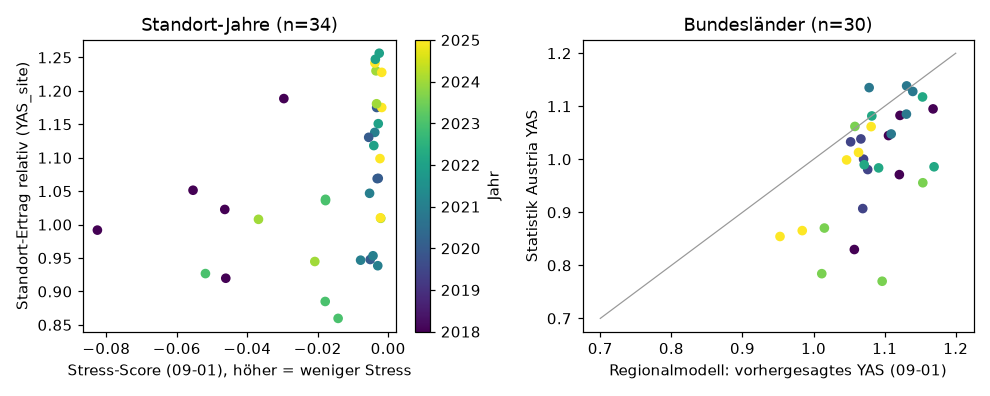

# Österreich-Test (erster, explorativ) – Ergebnis

Stand 2026-10-17. Protokoll: `reports/freeze_protocol_at.md` (Tag `freeze-at-1`, vor jeder Auswertung festgeschrieben). Lauf: `results/2026-10-17_at_test/`
(`metrics.json`, `site_year.csv`, `region_year.csv`, `qc.json`, `review.json`). Datenkritik: `reports/data_review/at_test.md`. Ein Lauf, nach dem Ergebnis wurde nichts geändert;
das Protokoll sah keinen Sieger vor und es wird keiner gewählt.

> **Einordnung:** Erster, **explorativer** Test. Das Phase-4-Kriterium „stark genug“ war von keinem Feldmodell erfüllt; der Test läuft auf Entscheidung des Projektinhabers (DECISIONS 2026-10-17).
> Er stützt höchstens eine Aussage über **gute und schlechte Jahre** (Rangfolge), nicht über t/ha und nicht über einzelne Felder.

## Kurzfassung

1. **Stress-Score (Feldebene) → Standorterträge (V2-A): „bestanden“ nach Protokoll.** ρ = 0,50 [0,19; 0,68] am Stichtag 1.9. (34 Standort-Jahre, 7 Jahre als Cluster); bestanden an allen vier Stichtagen
   (0,46 / 0,55 / 0,65 / 0,50). **Aber:** das einfache, ohne Lernen berechnete Vergleichsmerkmal „mittleres NDVI Juni–August“ erreicht dasselbe (ρ = 0,50 [0,09; 0,65]), der Score leistet also **nicht mehr** als „grün ist gut“.
2. **Der Zusammenhang ist vor allem ein Jahreseffekt.** Über die 7 Jahresmittel ρ = 0,79; nach Abzug der Jahresmittel bleibt ρ = 0,31, innerhalb eines Jahres zwischen den Standorten ρ im Median −0,1. Ohne die beiden belasteten Jahre (2018, 2023)
   sinkt ρ auf 0,37. Der Score trennt vor allem Jahre, nicht Standorte innerhalb eines Jahres. Dabei passt nur 2023 klar (zweitniedrigster Score, niedrigster Ertrag, YAS_site 0,95); **2018 hat den niedrigsten Score, aber nur durchschnittliche Erträge** (1,04), und 2022/2025 haben die höchsten Erträge bei Score ≈ 0.
3. **Regionalmodell (EU) → Bundesländer (V1): „bestanden, aber nicht stark“.** ρ = 0,52 [0,13; 0,75] am 1.9. (30 Region-Jahre, 6 Jahre; 2024/25 fehlen, weil die Wetter-Eingaben 2023 enden). Der Fehler (RMSE 0,121) ist **größer** als bei der Annahme „normales Jahr“ (0,101),
   Differenz +0,019 [−0,016; 0,043]; das Modell liegt im Mittel um +0,09 zu hoch (Vorhersage 1,08, Beobachtung 1,00). Am 15.7. ist ρ = −0,14 (nicht belegt); ab 1.8. positiv.
4. **Regionalmodell → einzelne Standorte (V2-B): nicht belegt** (ρ = 0,03 [−0,69; 0,70], 24 Standort-Jahre, 5 Jahre).
5. **Stress-Score als Bundesland-Mittel (V1-A): nicht belegt** (ρ = 0,38 [−0,37; 0,72], nur 12 Region-Jahre, 2 Bundesländer).
6. **Steiermark ist nicht getestet.** Alle 34 auswertbaren Standort-Jahre liegen in Oberösterreich: In der Steiermark (Wagna, Kalsdorf, Hatzendorf) gibt es nur Düngungs- und Bodenbearbeitungsversuche, keine Sortenversuche; das vorab festgelegte Auswahlkriterium (Sortenversuche) schließt sie aus.

## Tabelle (alle vorab festgelegten Stichtage; ρ [95-%-KI] (n Zeilen / Jahre als Cluster))

| Weg | 15.7. | 1.8. | 15.8. | **1.9.** | Urteil 1.9. |
|---|---|---|---|---|---|
| **V2-A** Stress-Score → `YAS_site` | 0,46 [0,11; 0,65] (30/7) | 0,55 [0,21; 0,67] (34/7) | 0,65 [0,40; 0,70] (34/7) | **0,50 [0,19; 0,68] (34/7)** | bestanden |
| V2-Vergleich: mittleres NDVI Jun–Aug | – | – | – | 0,50 [0,09; 0,65] (34/7) | (nur beschreibend) |
| **V2-B** Regionalmodell → `YAS_site` | 0,44 [−0,36; 0,82] (24/5) | 0,15 [−0,65; 0,70] (24/5) | 0,15 [−0,65; 0,70] (24/5) | **0,03 [−0,69; 0,70] (24/5)** | nicht belegt |
| **V1** Regionalmodell → Statistik Austria | −0,14 [−0,64; 0,47] (30/6) | 0,41 [0,06; 0,70] (30/6) | 0,51 [0,18; 0,75] (30/6) | **0,52 [0,13; 0,75] (30/6)** | bestanden, nicht stark |
| V1-A Stress-Score je Bundesland | 0,17 [−0,58; 0,67] (11/6) | 0,13 [−0,70; 0,59] (12/6) | 0,17 [−0,68; 0,74] (12/6) | 0,38 [−0,37; 0,72] (12/6) | nicht belegt |

Beschreibend (V2-A, 1.9.): Spearman innerhalb der 5 Standorte mit ≥ 6 Jahren (Median) 0,60 (Walding 0,82, Wimsbach 0,71, Innviertel 0,60, Mauthausen 0,54, **Linden −0,50**);
Leave-one-year-out 0,41–0,55; ohne zwei beliebige Jahre 0,35–0,60. V1 RMSE-Differenz zu „normales Jahr“ nach Stichtag: +0,042 / +0,021 / +0,016 / +0,019, nie mit KI unter 0.

## Was das heißt

- **Belegt (mit Vorbehalt):** In Oberösterreich liegen Jahre mit niedrigem Satelliten-NDVI im Mittel bei niedrigeren Versuchserträgen (Rangkorrelation über Standort-Jahre ≈ 0,5, über die 7 Jahresmittel 0,79). Das ist ein **Jahreseffekt** aus nur 7 Jahren, den ein einfaches NDVI-Maß ebenso zeigt, und er trägt vor allem 2023; 2018 (schlechtester Score, durchschnittlicher Ertrag) passt nicht.
- **Nicht belegt:** dass das aus US-Feldern gelernte Stress-Maß in Österreich *besser* ist als ein einfaches NDVI; dass es Standorte innerhalb eines Jahres ordnet; dass das Regionalmodell auf Standort-Ebene oder in der Steiermark etwas leistet; alles auf Feldebene (keine Feld-Ertragsdaten).
- **Regionalmodell:** Es hat ein schwaches Rangsignal zwischen Jahren und Bundesländern (ρ ≈ 0,5), ist aber als Ertragsschätzer **nicht besser als „normales Jahr“** und systematisch zu hoch (Trendanteil aus den EU-Trainingsjahren).
- **Genauigkeit der Konfidenzintervalle:** Mit 5 bis 7 Jahren als Cluster sind Bootstrap-Intervalle grob; die Urteile „bestanden“ hängen an wenigen Jahren (Leave-one-year-out stützt die Richtung).
- **„Uns fehlen Daten“ ist hier nur teilweise eine Erklärung:** Mehr Jahre und Standorte würden die Intervalle verengen; dass der Score *mehr* kann als NDVI, ist damit nicht gesagt (die NDVI-Gleichheit ist ein inhaltlicher Befund, kein Datenmangel).

## Nächste Schritte (Vorschläge, nichts davon ist gelaufen)

1. **Steiermark nachholen** (neues Protokoll `freeze-at-2`, vorab festgeschrieben): Düngungs-/Bodenbearbeitungsversuche (Wagna 7 Jahre, Kalsdorf, Hatzendorf) als Standortertrag zulassen; Vorbehalt: Düngungsstufen sind kein reiner Wettereffekt. Das ist ein *neuer* Test, nicht eine Verbesserung des gelaufenen.
2. Feld-Ertragsdaten Österreich (V3) – bisher keine; nur damit wäre eine Feldaussage möglich (`ANFRAGEN.md` Nr. 5).
3. Wenn der Score einen Mehrwert gegenüber NDVI haben soll: nur über eine neue, vorab festgelegte Modellrunde mit US-Daten (mehr Feld-Jahre), danach neuer Freeze.
