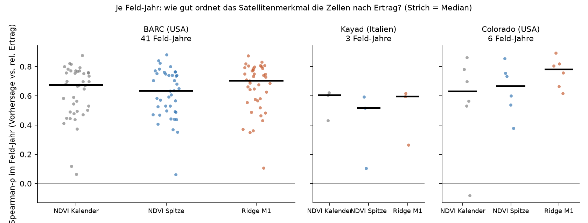
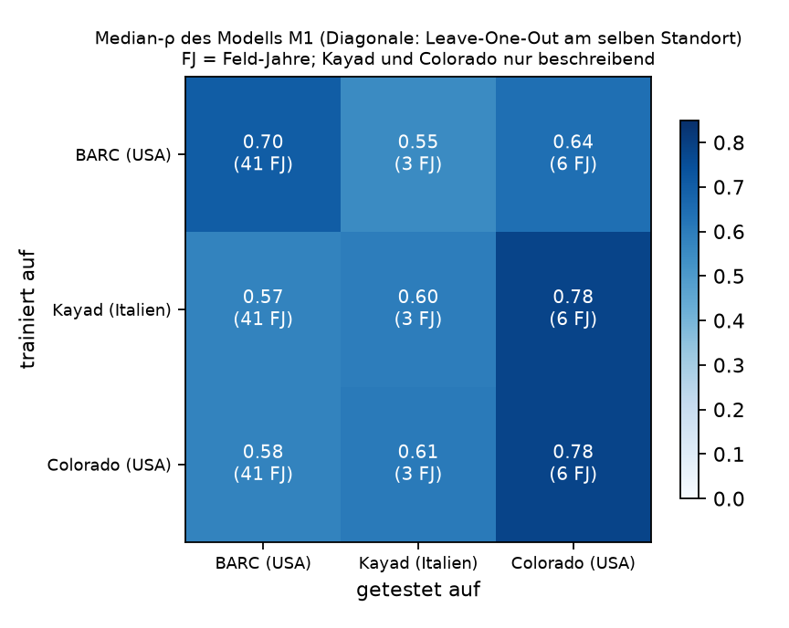
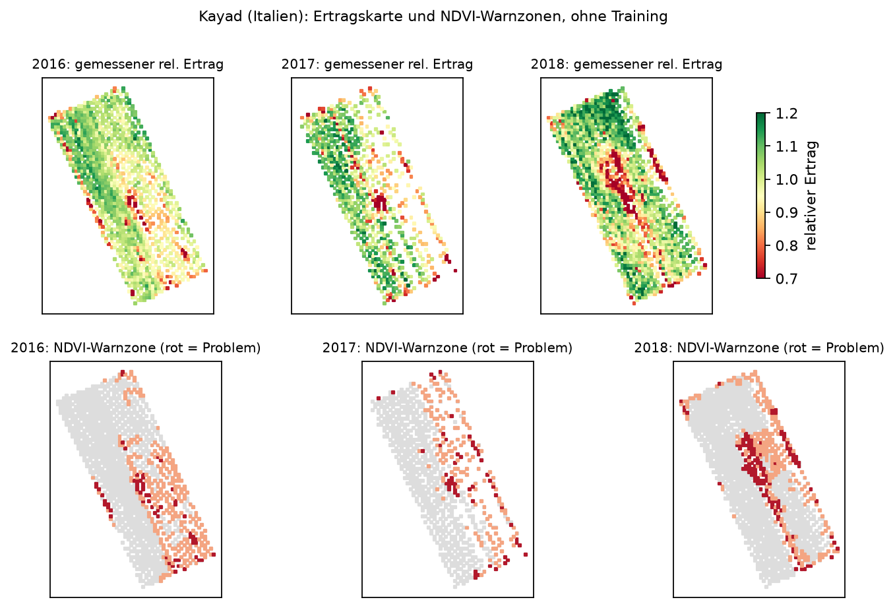

# Innerhalb-Feld über Standorte – Ergebnis (I4/I5)

Stand 2026-10-17. Plan: `reports/plan_innerfeld.md`; Vorab-Festlegungen: `reports/innerfeld_vorab.md` (Commit `ca0f987`, **vor** dem Lauf); Lauf: `results/2026-10-17_innerfeld/` (`metrics.json`, `per_fy.csv`, `git.txt`; Code `src/croptransfer/innerfeld_run.py`, Commit `d9c5e91`; beim Lauf war nur die zusätzliche Ausgabe der 20 Einzelwerte des Label-Shuffle noch nicht committet, alle anderen Zahlen sind davor und danach identisch); Datenkritik: `reports/data_review/if_i1_daten.md`, `if_i2_merkmale.md`, `if_i4_ergebnis.md`. Eine Modellrunde, keine Parameter verändert. Österreich nicht berührt.

## Kurzfassung

1. **Die Regel „unteres NDVI-Viertel = Problemzone“ gilt an allen drei geprüften Standorten in der gleichen Richtung.** BARC (Maryland, 41 Feld-Jahre): Median-ρ **0,67** [0,59; 0,74]. Kayad (Italien, 3 Feld-Jahre): 0,60. Colorado (6 reguläre Teilflächen-Jahre): 0,63. In 49 von 50 Feld-Jahren ist der Zusammenhang positiv (eine Ausnahme: Colorado S2 2019, ρ = −0,08).
2. **Bewiesen ist das nur für BARC.** Kayad hat ein Feld in drei Jahren, Colorado besteht aus Einzelpunkten (6 reguläre Feld-Jahre). Nach der vorab festgelegten Regel ist **Gate J2 („überträgt auf Fremdstandort“) nicht prüfbar**; alle Werte außerhalb BARC sind beschreibend.
3. **Spitzenfenster statt Kalenderfenster ist gleichwertig (K1 ✓):** Δρ (Spitze − Kalender) auf BARC −0,002 [−0,020; +0,001]. Damit ist das Fenster nicht mehr an den Kalender gebunden. Auf Kayad (Maximum im Juni) war das Kalenderfenster beschreibend sogar besser (0,60 gegenüber 0,52).
4. **Training bringt auf BARC etwas, aber wenig (J3a ✓ mit Vorbehalt):** Modell M1 (Ridge auf drei Fenster, NDVI und NDRE, Leave-One-Field-Out) 0,70 [0,64; 0,75]. Differenz zum Spitzenfenster **+0,046** [0,031; 0,059], zum Kalenderfenster **+0,037** [0,024; 0,060]. Der Lift des untersten Viertels steigt nur von 2,26 auf 2,31. In 68 % der Feld-Jahre ist M1 besser als B0.
5. **Training überträgt nicht besser als die Regel ohne Training:** Auf BARC getestet liefert ein auf Kayad oder Colorado trainiertes M1 ρ = 0,58 (Leave-One-Site-Out: 0,57), also weniger als der untrainierte NDVI (0,67). Auf Kayad liefert BARC-Training 0,55 (untrainiert 0,60), auf Colorado 0,64 bzw. 0,78 (untrainiert 0,63). Aus drei Standorten lässt sich keine Rangfolge ableiten.
6. **Geländemerkmale bringen nichts** (M2 − M1 auf BARC −0,001 [−0,009; +0,028]); eine reine Positionstendenz erklärt fast nichts (K-Raum 0,03).

## 1. Ergebnisse je Standort

Median-ρ über Feld-Jahre; KI = 95 %, Cluster-Bootstrap über Felder (BARC). Kayad (3) und Colorado (6) haben weniger als 10 Feld-Jahre und bekommen vorab nur Punktwerte. SD = Streuung des relativen Ertrags (Median über Feld-Jahre).

| Standort | SD rel. | B0 Kalenderfenster | B1 Spitzenfenster | M1 (Ridge, Leave-One-Out) | Anteil ρ > 0 (B0) | Lift B0 |
|---|---|---|---|---|---|---|
| **BARC** (41 FJ, 27 Felder) | 0,26 | **0,674** [0,59; 0,74] | 0,632 [0,53; 0,72] | **0,702** [0,64; 0,75] | 100 % | 2,26 |
| Kayad (3 FJ, 1 Feld) | 0,14 | 0,604 | 0,516 | 0,596 (Leave-One-Year-Out, optimistisch) | 100 % | 2,54 |
| Colorado (6 FJ) | 0,16 | 0,631 | 0,667 | 0,781 (Leave-One-Plot-Out) | 83 % | 2,74 |

Kayad je Jahr (B0): 2016 0,60 · 2017 0,62 · 2018 0,43. Lift = Problemzonen-Anteil im Viertel mit niedrigster Vorhersage ÷ Anteil insgesamt (höchster möglicher Wert bei Anteil 12 % und 25 % Markierung: 4). Kontrolle: das alte feste Fenster aus Phase 2.3 gibt auf BARC 0,676 (berichtet: 0,676).

## 2. Gates nach Vorab-Regel

| Gate | Regel (vorab) | Ergebnis | Urteil |
|---|---|---|---|
| **J2** Regel überträgt | Fremdstandort mit ≥ 10 Feld-Jahren, ρ ≥ 0,30, KI-Untergrenze > 0 | kein Fremdstandort mit ≥ 10 Feld-Jahren (Kayad 3, Colorado 6) | **nicht prüfbar** (so vorab festgelegt) |
| **K1** Fensterwahl | Δρ (B1 − B0) auf BARC ≥ −0,03, KI-Untergrenze ≥ −0,06 | −0,002 [−0,020; +0,001] | **✓** |
| **J3a** Training lohnt (BARC) | M1 − B1 und M1 − B0 je ≥ +0,03, KI-Untergrenze > 0; Label-Shuffle | +0,046 [0,031; 0,059] und +0,037 [0,024; 0,060]; Label-Shuffle siehe unten | **✓ mit Vorbehalt** |
| **J3b** Training lohnt (fremd) | wie J3a auf Fremdstandorten | nicht prüfbar (< 10 Feld-Jahre) | **nicht prüfbar** |

**Label-Shuffle (Kontrolle zu J3):** 20 Wiederholungen mit gemischtem Trainingsziel. Mittelwert des Median-ρ: **+0,03** (Leave-One-Field-Out auf BARC) und **−0,03** (BARC → Kayad), beide innerhalb der Grenze ±0,10. Die einzelnen Wiederholungen streuen aber stark (SD 0,20/0,27, Maximum im Betrag 0,45/0,52, 65 % bzw. 50 % positiv): Die Ridge-Regression wählt auf gemischten Zielen ein zufälliges Vorzeichen für die gemeinsame Richtung der stark verwandten NDVI/NDRE-Merkmale. Der Vorab-Wortlaut („Median-ρ … ≤ 0,10“) ist mehrdeutig; gelesen als Mittelwert über die Wiederholungen ist er erfüllt, gelesen als „jede Wiederholung“ nicht. Die zweite Lesart ist bei so kollinearen Merkmalen nicht aussagekräftig (gleiche Erfahrung wie in der Feinjustierung). Das tatsächliche M1-Ergebnis (0,70) liegt über **allen** 20 Wiederholungen (größte: 0,45), BARC → Kayad (0,55) knapp über der größten (0,52, bei nur 3 Feld-Jahren). Deshalb „✓ mit Vorbehalt“.

**Gesamtaussage (vorab festgelegte Formulierung):** „Das einfache NDVI-Fenster ist ein gleichwertiger, kalenderfreier Ersatz (K1); Training bringt auf BARC etwas (J3a, +0,04 ρ, kaum mehr Lift); ob das anderswo gilt, ist nicht geprüft (J2, J3b nicht prüfbar).“

## 3. Transfer-Matrix (nur beschreibend außer BARC)

Median-ρ des Modells M1, Zeile = Training, Spalte = Test. Diagonale: Leave-One-Out am selben Standort.

| trainiert auf ↓ / getestet auf → | BARC (41 FJ) | Kayad (3 FJ) | Colorado (6 FJ) |
|---|---|---|---|
| BARC | 0,70 | 0,55 | 0,64 |
| Kayad | 0,57 | 0,60* | 0,78 |
| Colorado | 0,58 | 0,61 | 0,78* |

\* Leave-One-Year-Out bzw. Leave-One-Plot-Out, nicht vergleichbar mit Leave-One-Field-Out. Leave-One-Site-Out: BARC 0,57, Kayad 0,57, Colorado 0,66.

Lesart: Ein auf einem kleinen Standort trainiertes Modell verliert auf BARC gegenüber dem untrainierten NDVI (0,57–0,58 gegenüber 0,67). Umgekehrt liefert BARC-Training auf Kayad weniger als der rohe NDVI (0,55 gegenüber 0,60), auf Colorado etwa gleich viel (0,64 gegenüber 0,63). Mit 3 und 6 Feld-Jahren ist das **kein Beleg** für einen Standorteffekt, aber auch keiner dafür, dass Training überträgt.

## 4. Kontrollen und Sensitivitäten

| Prüfung | Ergebnis |
|---|---|
| Randabstand ≥ 20 m (BARC) | B0 0,684, B1 0,691, M1 0,730: kein Randeffekt |
| Kayad ohne 2016 (2 FJ) | B0 0,526, B1 0,310: bei zwei Jahren nicht belastbar |
| Kayad ohne gedeckelte Zellen | B0 0,607, B1 0,507: unverändert |
| Colorado alle 10 Teilflächen-Jahre (inkl. 4 Totalausfälle) | B0 0,548 [0,23; 0,74], B1 0,568 [0,44; 0,76]; die J2-Bedingung wäre hier formal erfüllt, gilt aber nicht (Gate auf die 6 regulären Jahre festgelegt, Einzelpunkte, Pseudoreplikation) |
| Positionsmodell K-Raum (nur x, y) | BARC 0,03 [−0,04; 0,29]; Transfer −0,22…0,33: das Satellitensignal ist keine glatte räumliche Tendenz |
| Gelände M2 vs. M1 (BARC) | −0,001 [−0,009; +0,028] |
| Wiederkehr B2 (Zelle in anderen Jahren) | nur 8 BARC-Feld-Jahre und die 3 Kayad-Jahre zuordenbar (BARC-Feld-IDs und Zellraster wechseln zwischen Jahren): BARC 0,71 (nur beschreibend), **Kayad 0,24**: Die Zonen von Kayad wiederholen sich weniger, ρ(B0) 0,60 ist also nicht nur „Boden“ |
| SD des relativen Ertrags neben jeder Zahl | BARC 0,26 · Kayad 0,14 · Colorado 0,16 (Tabelle 1) |

## 5. Grenzen

- **Ein großer Standort.** Alle belastbaren Intervalle stammen von BARC (41 Feld-Jahre, 27 Felder, kriging-interpolierte Ertragskarten). Kayad ist ein Feld, Colorado Einzelpunkte; die Reihenfolge der Standorte in Abschnitt 3 ist Zufallsrauschen, solange n so klein ist.
- **Gewinn von M1 klein:** +0,04 im ρ, +0,05 im Lift. Wofür M1 die Information nimmt (frühes/spätes Fenster, also vielleicht Saat- oder Auflaufunterschiede innerhalb des Feldes) ist nicht geprüft.
- **Bewirtschaftung im Feld:** Kayad hatte variable Stickstoffgabe (Düngekarte liegt nicht vor), die Karten zeigen Fahrstreifen (siehe Abbildung); BARC-Zonen können Boden oder Fahrgassen sein. Ein Alarm heißt „auffällige Kurve“, nicht „Stress“.
- **Unerklärter Jahrestrend:** Auf BARC steigt B0 von 0,51 (2017) auf 0,76 (2021). Die Zahl klarer Aufnahmen erklärt das nicht (ρ 0,18 zwischen Aufnahmezahl und Feld-Jahr-ρ).
- **Zwei schwache BARC-Feld-Jahre** (APU_1 2021: ρ 0,06; CentralFarm_2_71 2019: ρ 0,12) haben keine auffälligen Datenmerkmale (Zellen 463 bzw. 1 279, klare Aufnahmen 2); Ursache offen.
- **Kein Test in Österreich.** Weder Feldkarten noch Modell. Dafür wären Ertragskarten aus der Steiermark nötig (`ANFRAGEN.md`, V3).
- **Fehlende Standorte:** DWFI und SwissYield stehen aus (Anfragen Nr. 10/11 liegen beim Projektinhaber), CH-TAN unter Embargo bis 2028.

## 6. Was als Nächstes die Aussage verändern würde

- **DWFI-Karten** (3 Felder, 2021–2024) oder **SwissYield** (5 Jahre, mehrere Kulturen) würden Kayad und Colorado auf ≥ 10 Feld-Jahre ergänzen; erst dann wäre J2 prüfbar. Der Code ist vorbereitet: neuer Standort in `gt_pixels` aufnehmen, `innerfeld_extract` und `innerfeld_run` erneut laufen lassen (Vorab-Regeln unverändert; neue Standorte sind dann nur Test, kein Eingriff in Parameter).
- **Österreich:** erst nach Testprotokoll, Freeze und Freigabe.
