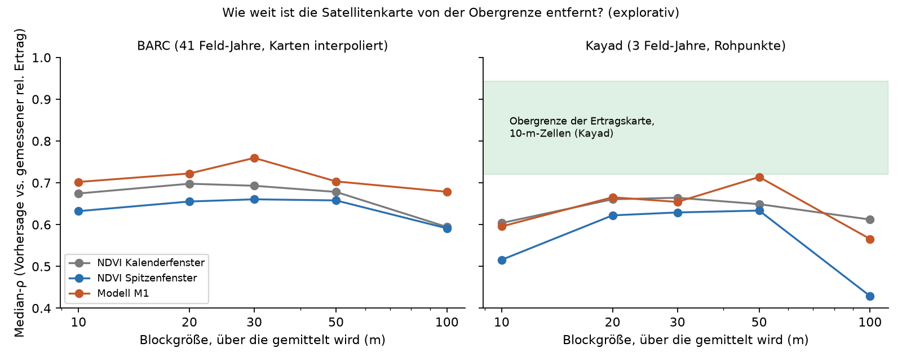

# Wie nah sind wir an der Obergrenze? (explorativ)

Stand 2026-10-17. Zahlen: `results/2026-10-17_innerfeld_ceiling/metrics.json`, Code `src/croptransfer/innerfeld_ceiling.py`, Tests `tests/test_innerfeld_ceiling.py`. Zugehörig zu `reports/innerfeld_ergebnis.md`.

**Status:** explorativ und beschreibend. Es wird nichts trainiert, nichts ausgewählt, kein Gate geprüft, und kein Parameter der vorab festgelegten Runde (`innerfeld_vorab.md`) ändert sich. Die Zahlen dürfen deshalb **nicht** als neues Ergebnis oder als Grund für eine Methodenwahl gelesen werden, sondern nur als Einordnung.

## Frage

Die Ertragskarte ist selbst verrauscht (GPS, Fließverzögerung im Mähdrescher, Streifen, Interpolation). Kein Satellit kann besser als die Messung sein. Wie hoch kann ρ unter diesen Umständen überhaupt werden, und wo stehen wir?

## A. Wie zuverlässig ist die Ertragskarte? (Kayad, Rohpunkte)

Die Punkte jedes 10-m-Feldes werden in zwei Hälften geteilt; je Hälfte wird der Mittelwert gebildet, dann ρ zwischen den Hälften. Daraus (Spearman-Brown) folgt die Zuverlässigkeit R der vollen Messung und als Obergrenze für die Korrelation eines **perfekten** Vorhersagers mit der Messung etwa √R.

| Jahr | Teilung | Zellen | ρ zwischen Hälften | Obergrenze ≈ √R |
|---|---|---|---|---|
| 2016 | zufällig (optimistisch) | 1 674 | 0,82 | **0,95** |
| 2016 | nach Fahrspur (pessimistisch) | 677 | 0,45 | **0,79** |
| 2017 | zufällig | 1 483 | 0,81 | 0,94 |
| 2017 | nach Fahrspur | 377 | 0,30 | 0,68 |
| 2018 | zufällig | 1 774 | 0,77 | 0,93 |
| 2018 | nach Fahrspur | 1 070 | 0,32 | 0,70 |

- **Zufallsteilung (optimistisch):** Die Hälften stammen aus derselben Fahrspur, nur wenige Meter auseinander. Sie sind sich dadurch zu ähnlich, die Obergrenze ist zu hoch.
- **Teilung nach Fahrspur (pessimistisch):** Die Hälften kommen von verschiedenen Fahrspuren (58–69 Spuren je Jahr). Zwei Spuren überdecken aber auch verschiedene Streifen derselben Zelle, die Hälften unterscheiden sich also teils wirklich. Die Obergrenze ist zu niedrig.
- **Die Wahrheit liegt dazwischen:** Mittel über die drei Jahre **≈ 0,72 bis 0,94**.

## B. Vergleich mit „Nachbarn kennen“

Wie gut sagt der Mittelwert der bis zu 8 Nachbarzellen den relativen Ertrag einer Zelle voraus (ρ je Feld-Jahr, Median)?

| Standort | ρ Nachbarn → Zelle | Bemerkung |
|---|---|---|
| Kayad (3 FJ) | **0,71** (0,54–0,72) | Rohpunkte, kein Kriging |
| BARC (41 FJ) | 0,94 (0,84–0,97) | **nicht verwendbar:** Kriging macht die Karte künstlich glatt |

Der Satellit (Kayad, rohes NDVI-Fenster ρ 0,60) erreicht damit rund **85 %** dessen, was man mit Kenntnis der Nachbarerträge schaffen würde.

## C. Wie hängt ρ von der Zellgröße ab?

Vorhersage und Messung werden über Blöcke von 10 bis 100 m gemittelt; ρ je Feld-Jahr, Median. B0 und B1 sind untrainiert, M1 sind die Vorhersagen außerhalb des Trainings (BARC Leave-One-Field-Out, Kayad Leave-One-Year-Out).

| Standort / Modell | 10 m | 20 m | 30 m | 50 m | 100 m |
|---|---|---|---|---|---|
| BARC B0 (Kalenderfenster) | 0,674 | 0,698 | 0,693 | 0,678 | 0,594 |
| BARC B1 (Spitzenfenster) | 0,632 | 0,655 | 0,661 | 0,658 | 0,591 |
| BARC M1 | 0,702 | 0,722 | **0,760** | 0,703 | 0,679 |
| Kayad B0 | 0,604 | 0,661 | 0,664 | 0,649 | 0,612 |
| Kayad B1 | 0,516 | 0,622 | 0,629 | 0,634 | 0,429 |
| Kayad M1 | 0,596 | 0,665 | 0,654 | 0,714 | 0,566 |

Anzahl Feld-Jahre: 41 (BARC, bei 100 m nur 27 mit mindestens 10 Blöcken) und 3 (Kayad).

## Einordnung

1. **Kayad (Rohpunkte):** Die Satellitenkarte (0,60 auf 10 m) liegt bei etwa **84 %** der pessimistischen Obergrenze (≈ 0,72) und bei **64 %** der optimistischen (≈ 0,94). Es gibt also Luft, aber nicht beliebig viel. Ein realistischer Gewinn durch bessere Aufbereitung liegt eher bei einigen Hundertsteln als bei 0,2.
2. **BARC:** Die Obergrenze ist **nicht bestimmbar**, weil nur interpolierte Karten vorliegen. Die Nachbarn-Zahl (0,94) ist durch das Kriging aufgebläht. M1 mit 0,70 kann nahe an der Grenze liegen, wir können es nicht sagen.
3. **Mitteln hilft ein wenig:** Über 20–30 m steigt ρ auf BARC bei B0 um +0,02, bei M1 um bis +0,06 (0,76), auf Kayad bei B0 um +0,06. Jenseits von 50 m fällt es wieder. Ein Teil davon ist weniger Rauschen, ein Teil aber nur eine gröbere Aufgabe (größere Zonen sind leichter zu ordnen). Eine bessere Karte ist das nicht.
4. **Die Obergrenze gilt für die Messung, nicht für den Satelliten.** Boden, Saatzeitpunkt, Sorte und Düngung können zwischen den Zellen wirklich verschieden sein, ohne dass NDVI sie sieht. Die tatsächliche Grenze für ein NDVI-basiertes Verfahren liegt deshalb **unter** den Zahlen oben.

## Was daraus folgt (Vorschläge, nichts davon ist ausgeführt)

- **Aufbereitung der Ertragskarte** (Fahrstreifen, Monitor-Deckel, Randpunkte) und **Glättung auf 20–30 m** haben den größten rechnerischen Spielraum. Beides wäre eine neue, vorab festgelegte Modellrunde mit neuer Entscheidung des Projektinhabers; ausgewertet werden müsste auf Kayad **und** BARC (und später auf neue Standorte), nicht nur auf BARC.
- **Mehr Merkmale** (einzelne Aufnahmen statt Dekaden-Mittel, Kurvenform) sind unsicher: Auf Kayad ist der Satellit schon bei 84 % der pessimistischen Grenze.
- **Neue Standorte** bleiben der verlässlichste Hebel, weil sie zeigen, ob eine Änderung wirklich besser ist.

## Grenzen dieser Analyse

- Nur Kayad liefert Rohpunkte, also nur **3 Feld-Jahre eines Feldes**. Die Obergrenze für andere Standorte kann anders sein.
- Spearman-Brown und √R sind Näherungen für Pearson-Korrelationen; hier auf Rangkorrelationen angewendet.
- Die Teilung nach Fahrspur wurde aus der Punktreihenfolge abgeleitet (neue Spur, wenn der nächste Punkt über 6 m entfernt liegt); sie ist keine Information aus der Datenquelle. Es bleiben nur 377–1 070 Zellen, weil beide Hälften mindestens 3 Punkte brauchen.
- Die Obergrenzen in Teil A gelten für **10-m-Zellen**; bei größeren Blöcken steigt die Zuverlässigkeit und die Obergrenze mit.
- BARC-Zahlen in Teil B sind wegen der Interpolation nicht zu deuten.
